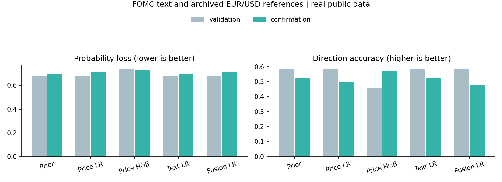
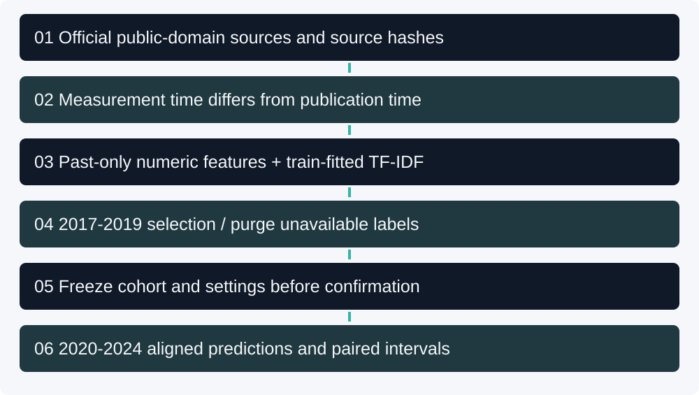
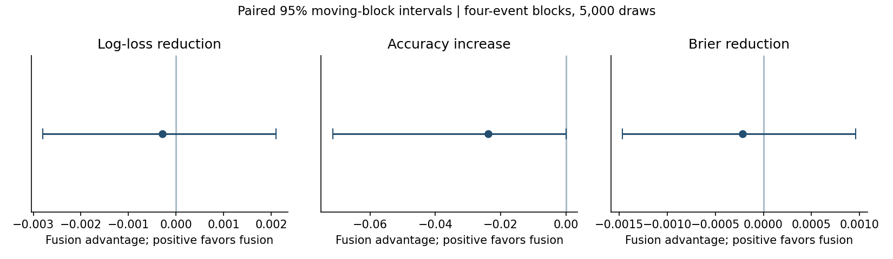

[](https://github.com/Mingju-Zhang-CBS/financial-text-validation/actions/workflows/checks.yml)

[Research Studio](https://github.com/Mingju-Zhang-CBS) · [Research directory](https://github.com/Mingju-Zhang-CBS/Quant)

# Financial Text Validation

**Does financial text add predictive information beyond prices when both information clocks are respected?** The implementation provides a real public-data experiment connecting FOMC policy statements, archived EUR/USD reference quotes, temporal data engineering, TF-IDF, price baselines and probability evaluation. The central contribution is an inspectable comparison in which a daily quote enters the feature set only after its actual weekly publication.

## Read the measured finding first

- **Data:** 128 official statements and 4,041 first-published reference observations; no commercial news or company data.
- **Retained events:** 60 training, 24 validation and 42 confirmation. Train ends in 2016; selection uses 2017–2019; the fixed confirmation period is 2020–2024.
- **Primary comparison:** selected price model `price_logistic` versus fusion. Log-loss reduction, price minus fusion: **-0.00029**, paired 95% interval **[-0.00280, 0.00211]**. Positive favors fusion.

**Research judgment:** The paired interval includes zero: this experiment does not establish incremental text value. The sample is small and event-conditioned; it does not support a claim of tradable alpha, causal policy impact or an official competition score. A result that does not favor the richer model remains part of the portfolio.

|Model|Confirmation accuracy|Log loss|Brier|
|---|---:|---:|---:|
|historical_up_frequency|0.524|0.6954|0.2511|
|price_logistic|0.500|0.7171|0.2603|
|price_hist_gradient|0.571|0.7295|0.2635|
|text_logistic|0.524|0.6937|0.2503|
|fusion_logistic|0.476|0.7174|0.2605|



Read [the complete executed report](reports/demo/REPORT.md), [paired uncertainty](reports/demo/paired_uncertainty.csv) and [all aligned probabilities](reports/demo/aligned_predictions.csv). The baseline is a fitted historical up probability; all rows and thresholds are shared across model families.

The nonlinear price control has the highest confirmation hit rate but a worse log loss than the simple prior. Text-only probabilities are close to the prior and their ranking AUC is below 0.5. These are reasons to examine confidence and calibration, not promote the best accuracy row.

## Skills demonstrated

|Capability|Evidence in this implementation|
|---|---|
|Financial data engineering|Official discovery links, source hashes, legacy-table parsing and first-published H.10 vintages.|
|Time-aware research|Separate statement, price-observation, price-release, decision and target-publication clocks.|
|Financial NLP|Body extraction, exact/near-duplicate handling, negation-preserving TF-IDF and fitted coefficient inspection.|
|Model validation|Linear/nonlinear price controls, text and fusion ablations, eleven development fits and frozen confirmation.|
|Statistical judgment|Proper probability losses, calibration, paired event-block uncertainty, all year slices and adverse results.|
|Research software|Packaged offline snapshot, explicit contracts, behavioral leakage tests, manifests and CI.|

## Why the three clocks matter

H.10 reports daily **noon measurement** rates in a **later weekly release**. Using the measurement date as same-day public availability would introduce hindsight. This project reads dated archives that the Board describes as not subsequently revised, conservatively assigns each release availability at 23:59 New York time and admits only already published observations.

The statement is treated as known at the end of its publication day. Decision time is the following day at 23:59; the target starts at the first later observed noon quote and ends 20 observations later. Thus this is a delayed reference-rate prediction task, not the immediate announcement reaction. Labels not yet publicly released at a split boundary are removed from earlier training.



Current historical policy pages can contain editorial corrections. Price vintages are explicitly controlled; statement bytes are not claimed to be a perfectly reconstructed original archive. [Methods](docs/METHODS.md) explains the remaining limits rather than labeling the whole dataset perfectly point-in-time.

## Reproduce offline

Use **Python 3.12** and a fresh environment:

```text
python -m venv .venv
```

Activate `.venv\Scripts\Activate.ps1` on Windows PowerShell or `source .venv/bin/activate` on macOS/Linux, then:

```text
python -m pip install -r requirements.lock.txt
python -m pip install --no-deps -e .
python -m pip check
python -m pytest
python -m financial_text_validation --demo --output local-runs/study
python examples/explain_event.py
```

`--demo` runs the **bundled real-data snapshot**, not synthetic research results. After installation, no network, key, paid model, GPU or company service is needed. Use a new output directory; checked-in results in `reports/demo/` are not overwritten. Standalone wheels include the public-data CSVs and protocol.

## Models and controls

The price logistic model uses 1/5/20/60-observation log returns, 20-observation volatility and quote age. A fixed small histogram-gradient model supplies a nonlinear price control. Text uses unigrams/bigrams with training-fitted vocabulary and IDF; no pretrained language model can introduce later training knowledge. Fusion concatenates the fixed text and numeric blocks.

Each logistic family compares C in 0.1/1/10 on validation log loss. Vocabulary, numeric scaling and hyperparameters never fit on confirmation. Selected settings and the reference price family are saved in [freeze.json](reports/demo/freeze.json) before final confirmation prediction; models refit only on earlier eligible data. Settings: `{'historical_up_frequency': None, 'price_logistic': 0.1, 'price_hist_gradient': None, 'text_logistic': 0.1, 'fusion_logistic': 0.1}`.

Predetermined diagnostics retain a training-label shuffle, an extra 14-day price-publication delay, a lower-similarity text subset and every confirmation year. A single shuffled fit is a sanity check, not a formal permutation significance test. The [diagnostics](reports/demo/diagnostics.json) cannot select a replacement headline model.



## Data rights, contribution and limitations

The [Board's reuse policy](https://www.federalreserve.gov/disclaimer.htm) permits copying/distributing public-domain Board information with attribution. Only normalized Board policy bodies, H.10 numbers and provenance are included; no seals, logos, third-party imagery or commercial news. [DATA_LICENSE.md](DATA_LICENSE.md) identifies exact sources and [the snapshot manifest](financial_text_validation/data/manifest.json) records individual URLs and hashes. [H.10 documentation](https://www.federalreserve.gov/releases/h10/about.htm) explains archived versus current-vintage series.

The study implements the collector, temporal panel, comparative modeling and evidence workflow for this public study. Development and documentation were AI-assisted. Prior coursework motivated the question; original course/group/employer materials are excluded. This is a separately designed task, not a reproduction or submission to XForecast. Newly authored code is MIT licensed; source data and dependencies keep their separate rights.

One currency and a small set of policy events restrict generalization. Overlapping target windows, repeated policy language, regime shifts and snapshot corrections limit inference. Bootstrap intervals are unadjusted and conditional on the frozen design. Reference rates have no executable bid/ask, queue or financing model, so classification scores are not trading returns. Once inspected, this historical confirmation period is exposed.

## Continue reading

- [Methods and leakage contract](docs/METHODS.md)
- [One actual event, explained numerically](docs/WALKTHROUGH.md)
- [Executed study, controls and figures](reports/demo/REPORT.md)
- [Behavioral tests](tests/test_time_contracts.py)
- [Technical discussion](docs/DISCUSSION.md)
- [Attribution and implementation boundaries](docs/PROVENANCE.md)
