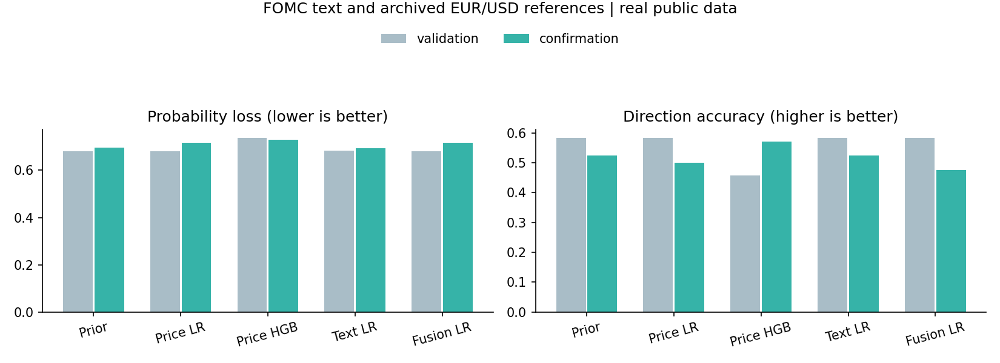

# Financial Text Validation

Do FOMC statements improve EUR/USD direction forecasts beyond already published price history? This historical study compares price, text and fusion models using **128 official statements**, **4,041 first-published H.10 reference quotes** and 42 retained confirmation events in 2020–2024.

**Finding.** The frozen fusion model did not improve confirmation log loss over the selected price model. The paired log-loss reduction (price minus fusion) was **−0.00029**, with a 95% interval of **[−0.00280, 0.00211]**.

[FOMC/FX results](reports/demo/REPORT.md) · [Methods](docs/METHODS.md) · [Run the study](#run-the-study)



*Public FOMC and H.10 confirmation sample. Higher accuracy and lower probability losses are favorable. The simple historical-frequency baseline is shown alongside the fitted models.*

## When information enters the model

H.10's daily noon observations are published in a later weekly release. Features use the first archived release and assign availability at 23:59 New York time. The forecast is issued at 23:59 the day after the statement. Its target starts at the first later noon quote and ends 20 observations later.

TF-IDF vocabulary and numeric scaling fit on training rows. Model settings are frozen before confirmation, with a historical-frequency baseline, price-only, text-only and fusion comparisons. Overlapping targets, repeated policy language and a small event sample limit inference. Current statement pages can include editorial corrections. H.10 observations are reference rates, so the comparison measures probability forecasts.

[Worked event](docs/WALKTHROUGH.md) · [Frozen model settings](reports/demo/freeze.json) · [Paired uncertainty](reports/demo/incremental_uncertainty.png) · [Timing tests](tests/test_time_contracts.py)

## Company-news extension

A separate [B0/B1/B2 ablation](docs/company-news/STRATEGY_COMPARISON.md) compares a market-only baseline with structured news features. Reported costed reference returns are **−55.13%**, **−55.47%** and **−56.21%** respectively. Paired incremental intervals include zero. The aggregate reference report records delay-ordering reversals and conditional terminal-settlement assumptions. The [public runnable fixture](research/company_news/README.md) uses invented inputs.

## Run the study

Use Python 3.12 from the repository root. Activate the virtual environment with `.venv\Scripts\Activate.ps1` in PowerShell or `source .venv/bin/activate` on macOS/Linux.

```bash
python -m venv .venv
# Activate the environment before installing.
python -m pip install -r requirements.lock.txt
python -m pip install --no-deps -e .
python -m pip check
python -m pytest -q tests research/company_news
python -m financial_text_validation --demo --output local-runs/study
```

Here `--demo` runs the bundled **real public FOMC/H.10 snapshot**. It runs offline after installation. Use a fresh output directory. Sources, exact releases and hashes are recorded in the [dataset manifest](financial_text_validation/data/manifest.json).

[Data license](DATA_LICENSE.md) · [Attribution and AI assistance](docs/PROVENANCE.md) · [Technical discussion](docs/DISCUSSION.md) · [Research directory](https://github.com/Mingju-Zhang-CBS/Quant)
