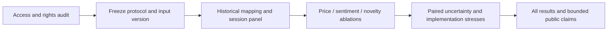

# Company News: Novelty, Sentiment and Market Response

**Question:** When do news sentiment, novelty and past media coverage provide information beyond price history?

**Status: implementation and synthetic verification; real-data audit blocked by server authentication.** No RavenPack/CRSP sample, empirical performance or publication permission has been verified for this study. The existing [FOMC/FX findings](../../reports/demo/REPORT.md) remain a separate completed study, including their unfavorable incremental-information result.

This independent extension connects sentiment/event analysis, regularization, duplicate information and temporal measurement learned in coursework. Newly written code and invented inputs are public; original group submissions and licensed corpora remain outside the repository. Development is AI-assisted.

|Method background|Independent research extension|
|---|---|
|HW1: financial sentiment, firm-day panels, event returns, turnover|Historical entity/security links, complete panels, delayed labels and explicit cost reconciliation.|
|HW2: regularization and topics|Fixed Ridge ablations and training-only event-category representation; text topics deferred until same-corpus access.|
|HW3: document similarity and repeated information|Article/event multiplicity checks; cross-ID story deduplication remains an audited adapter requirement.|
|Final: policy-language change over time|Existing public FOMC study retained; shared information clocks, run records and adverse-result reporting.|

## Research chain



The [protocol](../../financial_text_validation/company_news/protocol.json), [methods](METHODS.md), [data contract](DATA_CONTRACT.md), [audit record](AUDIT.md), [decision log](DECISIONS.md) and [result record](RESULTS.md) form a single study. Synthetic execution exercises software contracts and cannot answer the research question.

## Run without a data subscription

Use the repository's Python 3.12 installation instructions, then run:

```text
python -m pytest tests/test_company_news.py
python -m financial_text_validation.company_news --synthetic --output local-runs/company-news-001
```

Use a fresh output directory each time. Outputs include all 18 horizon/target/model comparisons, daily cross-sectional IC, selected development settings, paired date-block intervals, 36 implementation scenarios, individual ledgers and a manifest with source/config/input/output hashes. Synthetic metrics stay under ignored `local-runs/`; they are not headline research evidence.

## Resume the real-data audit

The optional `wrds` dependency supplies the PostgreSQL driver. An existing libpq service or private passfile supplies authentication; never place credentials in source or command arguments.

```text
python -m pip install -e ".[wrds]"
python -m financial_text_validation.company_news.audit --output private-data/company-news-audit-001
```

This bounded command inspects metadata and SELECT privileges in a read-only transaction. It does not extract news rows, certify full-period coverage, resolve field meanings or authorize publication. Authentication failure produces a sanitized audit record. A successful connection still requires the full [audit checklist](AUDIT.md).

The normalized-input routines are engineering components, **not a completed RavenPack adapter**. Real extraction, vendor-specific score normalization, full mapping attrition, explanatory panel estimates, empirical figures and publication remain gated on the audit. No automatic substitution of a shorter period or course extract is allowed.

## Four questions for the eventual report

1. How does the descriptive price-response path vary with novelty?
2. What is the paired improvement over B0, including uncertainty and null findings?
3. What survives later entry, turnover costs and stock borrowing assumptions?
4. Which prespecified claims were unsupported, and what evidence motivates the next experiment?

Only an authorized real-data run can populate those answers. [Result and acceptance record](RESULTS.md).
