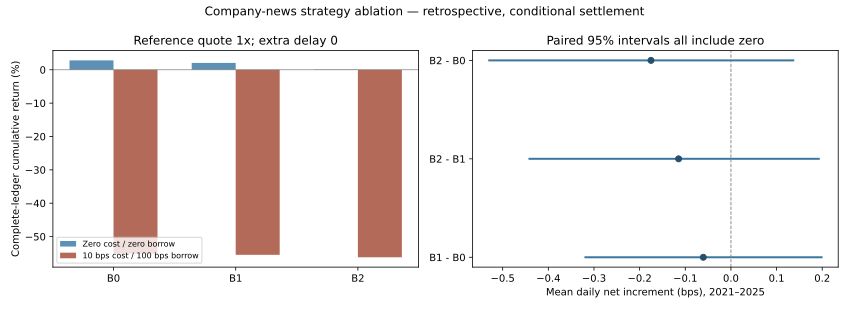

# Do news features add trading value? A frozen three-model comparison

**Result: no positive incremental trading value is established.** At the fixed costed reference, B0 returns **−55.127%**, B1 **−55.471%**, and B2 **−56.208%** cumulatively. B2 trails B0 by **1.0808 percentage points**. All three paired reference intervals include zero, so this is not evidence that news necessarily harms returns. Entry-delay changes reverse some relative point estimates, while all 324 reported paired intervals still include zero. All costed reference books lose money.

This is a **post-execution supplemental comparison**, requested after the original B2 outcomes had been inspected. It is not a new preregistered, prospective or independent confirmation test. The existing public FOMC/FX study and its unfavorable incremental-text result remain separate and unchanged.

## What is held fixed

The models use frozen historical forecasts for 2021–2025, originally developed on 2010–2020. The common ledger runs from 2021-01-04 through 2026-02-27, including the original liquidation buffer. No model is retrained, no forecast company-day is filtered by its subsequent target, and no source value is repaired for just one model.

|Model|Information used|
|---|---|
|B0|Price history, volatility, size, liquidity and past news coverage.|
|B1|B0 plus vendor sentiment, news-present and sentiment-missing indicators.|
|B2|B1 plus vendor novelty, missingness, sentiment interactions and event categories.|

This is a structured-news-score study, not a raw-news language-model experiment. B1/B2 increments are feature-bundle comparisons and cannot identify a single sentiment or novelty variable.

Each model uses the same top/bottom-decile ranking rule, five-session overlapping cohorts, entry after the signal at the next session close, equal capital per cohort, quote constraints, risk-budget treatment of locked positions, cost solver and cash-equivalent terminal valuation. The actual securities differ with model ranks; identical construction rules do not mean identical holdings.

The original engine is unchanged. **Every one of the 108 B2 ledgers reproduces its prior counterpart**, and all 324 model scenarios and 324 pairwise comparisons have complete conditional ledgers. Gross return, costs, borrow, net and security contributions reconcile; unquoted traded notional is zero. No failed or unfavorable historical attempt is overwritten.

## Fixed reference: absolute performance

Reference settings are final quote **1×**, extra delay **0**, **10 bps per one-way traded amount**, and **100 bps annual short borrowing**.

| Model | Zero-friction cumulative | Reference net cumulative | CAGR, including buffer | Max drawdown | Descriptive Sharpe | Annual one-way turnover |
| --- | --- | --- | --- | --- | --- | --- |
| B0 | +2.812% | -55.127% | -14.417% | -66.673% | -0.542 | 152.46x |
| B1 | +2.055% | -55.471% | -14.545% | -67.107% | -0.548 | 152.51x |
| B2 | +0.100% | -56.208% | -14.822% | -67.849% | -0.555 | 151.98x |

The zero-friction columns use separate zero-cost, zero-borrow rebalancing runs. B0's +2.812% cumulative gross result already provides very little margin for about 152x annual one-way turnover. B1 and B2 have smaller zero-friction gains. At 10 bps, turnover implies an approximate 15% annual arithmetic transaction-fee burden before borrowing; this is a scale illustration, not an additive decomposition of compounded CAGR. Costs overwhelm all three models.

## Does news add return relative to B0?

| Comparison | Cumulative difference (pp) | Mean daily net difference (bps) | Paired 95% interval (bps) |
| --- | --- | --- | --- |
| B1 minus B0 | -0.3443 | -0.0605 | [-0.3187, +0.1986] |
| B2 minus B1 | -0.7365 | -0.1146 | [-0.4413, +0.1924] |
| B2 minus B0 | -1.0808 | -0.1751 | [-0.5295, +0.1365] |

The inferential endpoint is the **same-date daily net-return difference over 2021–2025**, with paired 20-session moving blocks, 2,000 draws and seed 20261105. Cumulative differences compare full standalone-book terminal wealth including the common 2026 buffer. These are distinct endpoints. The intervals are unadjusted for multiple comparisons and conditional on the historical design and valuation rules.

At the reference, adding the sentiment/news-state bundle lowers observed cumulative return by 0.3443 pp; adding the novelty/interactions/event bundle lowers it by another 0.7365 pp. The combined B2–B0 difference is −1.0808 pp. Each confidence interval includes zero: **neither positive incremental trading value nor a reliably negative causal news effect is established**. A difference between standalone books is not the return of a separately funded, costed long-short overlay.

## Costs and delays: keep the changes in ordering

The following cost sweep fixes borrowing at 100 bps, quote at 1× and extra delay at zero.

| One-way cost (bps) | B0 | B1 | B2 |
| --- | --- | --- | --- |
| 0 | -1.803% | -2.527% | -4.401% |
| 5 | -33.619% | -34.118% | -35.297% |
| 10 | -55.127% | -55.471% | -56.208% |
| 20 | -79.496% | -79.660% | -79.941% |

The delay sweep fixes one-way fees at 10 bps, borrowing at 100 bps and quote at 1×.

| Extra entry delay (sessions) | B0 | B1 | B2 |
| --- | --- | --- | --- |
| 0 | -55.127% | -55.471% | -56.208% |
| 1 | -57.281% | -56.952% | -57.021% |
| 2 | -64.499% | -64.469% | -64.375% |

B2 is worse than B0 with no extra delay, but less negative by about 0.2591 pp with one extra session and 0.1239 pp with two. B1 also changes relative ordering. These reversals are retained; the study does not select the most favorable delay. Every model remains deeply negative in these costed delay cases.

Across the complete 108 configurations for each pair:

| Comparison | Configurations | Positive cumulative difference | 95% interval containing zero |
| --- | --- | --- | --- |
| B1 minus B0 | 108 | 72 | 108 |
| B2 minus B0 | 108 | 72 | 108 |
| B2 minus B1 | 108 | 36 | 108 |

Configuration counts are **not independent trials, probabilities of success, or votes for a model**. The configurations share forecasts and returns and differ mainly in implementation assumptions. Every interval includes zero. Each model has only three positive cumulative configurations: zero transaction fee, zero borrowing, no extra delay, repeated across the three terminal quote multipliers. A slight positive zero-friction result is not demonstrated feasible alpha.

## Terminal settlement: no reference conclusion reversal

| Final-quote multiplier | B0 | B1 | B2 |
| --- | --- | --- | --- |
| 0.5 | -55.127468% | -55.471754% | -56.208300% |
| 1.0 | -55.127197% | -55.471486% | -56.208035% |
| 1.5 | -55.126925% | -55.471217% | -56.207770% |

All nine model/quote reference books lose money, and the B0/B1/B2 reference ordering does not change. The quote sweep changes each model's cumulative result by less than **0.001 percentage point**. It also does not change the sign of the reference pairwise increments or their interval interpretation. In this tested range, terminal-price variation is far too small to explain the main losses or rescue a profitable-news claim.

These multipliers are assumed prices applied to reconciled terminal claims, not returns, statistical bounds or observed cash payments. The earlier observed-only references remain unestimable. Cash-equivalent conversion, stale locked claims and continuing borrow are explicit assumptions; completing a conditional ledger does not validate actual settlement or execution.

## Annual stability and risk

| year | buffer_year | B0 | B1 | B2 |
| --- | --- | --- | --- | --- |
| 2021 | False | -28.924% | -28.855% | -29.616% |
| 2022 | False | -24.306% | -25.766% | -26.378% |
| 2023 | False | -9.068% | -8.874% | -8.537% |
| 2024 | False | -13.978% | -13.514% | -13.826% |
| 2025 | False | +6.628% | +6.980% | +7.223% |
| 2026 | True | +0.000% | +0.000% | +0.000% |

The 2026 row is the liquidation buffer, not another forecast-confirmation year. All models lose in 2021–2024 and gain in 2025 under the fixed reference. No favorable year is removed or promoted as the primary result. Descriptive reference market betas are about 0.86–0.87; near-zero dollar net exposure does not establish market or factor neutrality. Full exposure and contribution summaries are in the aggregate JSON.

## Predictive result remains unchanged

The original primary date-equal-weight five-session market-adjusted MSE improvement, B0 minus B2, is **−4.70356×10⁻⁸**, with paired 95% interval **[−1.90580×10⁻⁷, +8.61831×10⁻⁸]**. It did not establish predictive improvement. The portfolio supplement reaches the compatible but separate judgment that positive net trading increment is not established under these rules.

This does not prove that all financial news is uninformative. It bounds the claim for this vendor-score representation, historical sample, Ridge models and portfolio implementation. Historical score vintages, source clocks, mapping uncertainty, funding, market impact, short availability and actual terminal cash flows remain limitations. A lower-turnover design or same-corpus text representation would be a new protocol and experiment, not a rebranding of these outcomes.

## Outputs and reproduction

- [All 324 aggregate model configurations](../../reports/company-news/model_strategy_scenarios.csv)
- [All 324 paired comparisons](../../reports/company-news/model_strategy_pairwise.csv)
- [Every reference year and terminal setting](../../reports/company-news/model_strategy_reference_years.csv)
- [Aggregate summary, reference diagnostics and selectors](../../reports/company-news/model_strategy_aggregate_summary.json)
- [Independent comparison implementation](../../research/company_news/cloud_model_strategy_comparison.py)
- [Report and verification implementation](../../research/company_news/cloud_model_strategy_report.py)
- [Invented-input regression tests](../../research/company_news/test_model_strategy_comparison.py)
- [Earlier source and terminal-return review](RETURN_REVIEW.md)

Run in an authorized WRDS Cloud environment with the earlier immutable private archives present: `cloud_model_strategy_comparison.execute(study)`, then `cloud_model_strategy_report.execute(study)`. Each stage refuses to overwrite an existing output directory and records exact source, protocol and private input/output fingerprints. Public readers can run the invented-input tests without a subscription. All original vendor observations, identifiers, forecasts, security contributions, date-level ledgers, fitted artifacts and commercial input hashes remain private. The files linked above contain researcher-authored aggregate experiment outputs, not a redistributed vendor dataset. Their publication grants no access or redistribution rights to the underlying sources.

Wharton Research Data Services (WRDS) was used in preparing this company-news research. This service and the data available thereon constitute valuable intellectual property and trade secrets of WRDS and/or its third-party suppliers.
