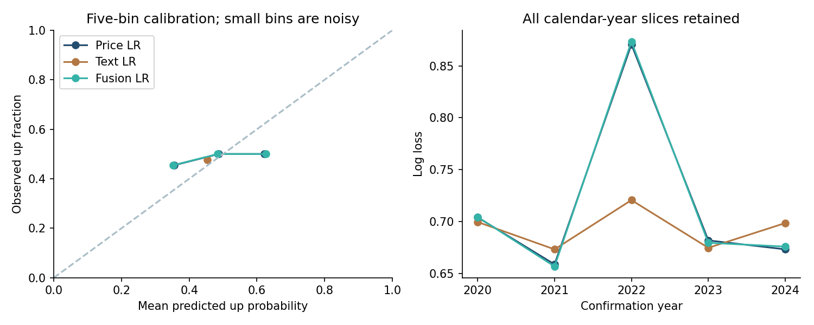
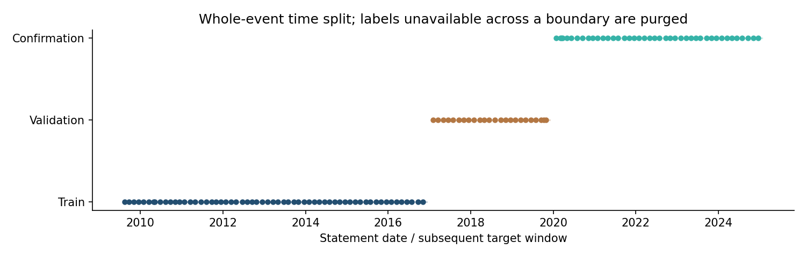

# Executed real-data study

Data: **real public FOMC statements and first-published archived H.10 EUR/USD reference quotes**. This is an independent historical study, not an XForecast score or an investment return.

## Registered experiment

128 statements, 4041 first-vintage daily quotes, 128 eligible events. Retained partitions: {'train': 60, 'validation': 24, 'confirmation': 42, 'final_fit': 85}. Exact duplicates and coverage exclusions: 0; split-boundary exclusions: 2.

The decision occurs at 23:59 New York time on the day after statement publication. Quotes enter features only after their actual archived H.10 release date, conservatively at 23:59. The target begins at the first later observed noon quote and ends 20 observations later. H.10 is weekly: a quote's measurement date does not imply same-day public availability.

## Model comparison

|Model|Accuracy|Log loss|Brier|
|---|---:|---:|---:|
|historical_up_frequency|0.524|0.6954|0.2511|
|price_logistic|0.500|0.7171|0.2603|
|price_hist_gradient|0.571|0.7295|0.2635|
|text_logistic|0.524|0.6937|0.2503|
|fusion_logistic|0.476|0.7174|0.2605|

The nonlinear price control has the highest confirmation direction hit rate, but a worse log loss than the simple prior. This illustrates why a larger accuracy number is insufficient: confidently wrong probabilities incur larger losses. The text-only model's probability loss is close to the prior while its ranking AUC is below 0.5. The fixed fusion specification does not establish added information under the primary contrast; it is not replaced after viewing these outcomes.

Best price family selected on validation only: **price_logistic**. Logistic C choices: {'historical_up_frequency': None, 'price_logistic': 0.1, 'price_hist_gradient': None, 'text_logistic': 0.1, 'fusion_logistic': 0.1}. The complete eleven-fit development grid is retained in development_search.csv. Final selected models refit on the earlier train/validation period after purging labels unavailable at confirmation start.

## Incremental text value

Confirmation log-loss reduction, selected price minus fusion: **-0.00029**, paired 95% moving-block interval **[-0.00280, 0.00211]**. Positive favors fusion. The interval includes zero; incremental text value is not established in this experiment.

The bootstrap uses 5,000 shared index draws in four-event blocks. These unadjusted intervals describe this frozen contrast; they do not account for every possible research choice or arbitrary long dependence. Accuracy and Brier contrasts are also retained.

## Controls and interpretation

diagnostics.json retains a fixed training-label permutation control, a 14-day extra publication-delay stress with unchanged settings, and a lower-text-similarity subset. All year slices are retained. A single shuffled fit is a diagnostic, not a permutation significance test. Coefficients describe fitted associations and can proxy the monetary-policy regime rather than a linguistic mechanism.

The universe is one currency and a small number of policy events. Near-repeated policy wording is flagged but retained because small edits can be economically meaningful; exact repeated bodies keep only the earliest occurrence. Current historical statement pages can have editorial corrections: archived H.10 quotes remove price-vintage hindsight, but do not prove original byte-for-byte statement vintages. Reference noon quotes are not executable bid/ask prices. No transaction-cost-adjusted P&L, immediate announcement effect or causal policy effect is claimed.

## Traceability

manifest.json binds source, protocol and data. freeze.json records selected settings and event IDs before confirmation prediction. event_panel.csv records the three clocks, price-feature cutoff, entry, label end and label availability. aligned_predictions.csv keys every model probability to the same event. Data URLs, raw source hashes and reuse policy are in ../../financial_text_validation/data/manifest.json. The complete report is generated by the final implementation; runtime is a local modeling workload, not trading latency.
